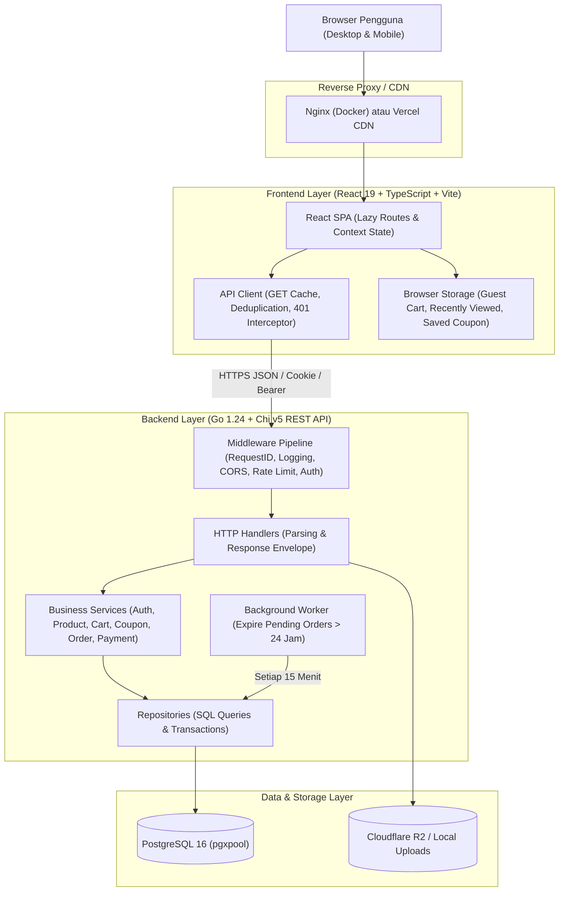
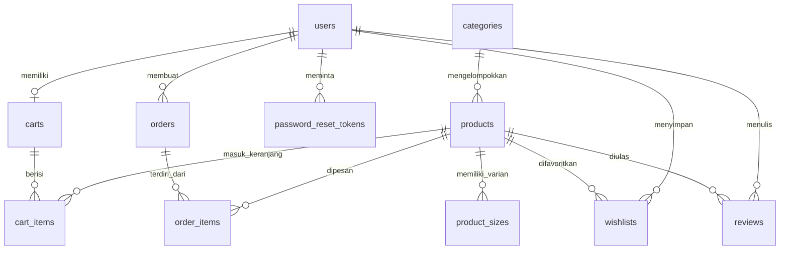
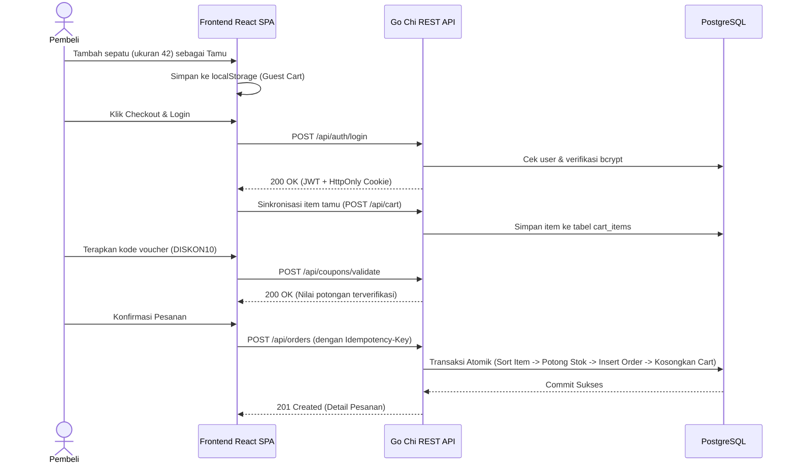

# Arsitektur & Teknik Rekayasa — Shoes4Us E-Commerce Platform

Dokumen ini menjelaskan arsitektur keseluruhan serta teknik-teknik rekayasa perangkat lunak yang digunakan dalam membangun **Shoes4Us E-Commerce Platform**. Penjelasan disusun agar **stakeholder** memahami cara kerja sistem dan alasan pemilihannya, sementara **developer** mendapatkan peta teknis yang akurat untuk memelihara dan mengembangkan aplikasi.

---

## 1. Gambaran Besar Sistem (High-Level Architecture)

Shoes4Us menggunakan arsitektur **Decoupled Full-Stack** (terpisah antara tampilan pengguna dan mesin logika server):
- **Frontend (React SPA):** Bertugas menampilkan katalog, interaksi cepat (keranjang geser, filter ukuran, pencarian), dan pengalaman belanja yang responsif di browser.
- **Backend (Go REST API):** Bertugas sebagai "otak" aplikasi yang memegang seluruh aturan bisnis, keamanan, autentikasi, validasi kupon, dan pengelolaan transaksi.
- **Database (PostgreSQL 16):** Menyimpan seluruh data relasional (pengguna, produk, varian ukuran, keranjang, pesanan, ulasan) dengan jaminan konsistensi transaksi (*ACID*).
- **Object Storage (Cloudflare R2 / Disk Lokal):** Menyimpan file gambar produk agar tidak membebani database.



**Kenapa arsitektur terpisah ini dipilih?**
1. **Skalabilitas Independen:** Frontend bisa di-hosting di CDN global (seperti Vercel) agar muat super cepat, sementara backend Go bisa di-scale terpisah di Railway/Render/VPS.
2. **Kecepatan & Efisiensi Resource:** Go dikompilasi menjadi binary statis berukuran ringan (~25 MB di container Alpine) dengan konsumsi memori rendah dan kemampuan menangani banyak koneksi bersamaan (*concurrency*).
3. **Siap Multi-Client:** Karena seluruh logika berada di REST API (`/api/*`), suatu saat jika dibuat aplikasi mobile (Android/iOS), backend yang sama langsung bisa dipakai ulang.

---

## 2. Arsitektur Frontend (`frontend/`)

Frontend dibangun dengan **React 19**, **TypeScript**, **Vite**, **React Router v7**, dan **Tailwind CSS**, mengikuti sistem desain *Architectural Monochrome Showroom* yang terdokumentasi di `DESIGN.md`.

### A. Pemecahan Kode (*Code Splitting* & *Lazy Loading*)
- **Apa artinya?** Alih-alih mengunduh seluruh kode halaman (termasuk halaman Admin yang tidak dipakai pembeli) saat pengguna pertama kali membuka beranda, browser hanya mengunduh halaman yang sedang dibuka.
- **Penerapan (`frontend/src/App.tsx`, `frontend/vite.config.ts`):**
  - Seluruh halaman dimuat dengan `React.lazy()` + `<Suspense fallback={<PageLoader />}>`.
  - Konfigurasi Rollup `manualChunks` memisahkan library inti yang jarang berubah (`vendor-react`, `vendor-icons`, `vendor-utils`) agar browser bisa menyimpannya di cache jangka panjang.

### B. Manajemen State dengan React Context API
Shoes4Us membagi state global secara modular tanpa membebani bundle dengan library state eksternal yang berat:
- **`AuthContext` (`frontend/src/context/AuthContext.tsx`):** Mengelola status login, peran `ADMIN`/`USER`, verifikasi profil `/auth/me` saat aplikasi dibuka, *silent refresh* (memperbarui profil tanpa memunculkan layar loading penuh), dan pembersihan sesi otomatis saat terjadi `401`.
- **`CartContext` (`frontend/src/context/CartContext.tsx`):** Mendukung belanja **tanpa login** (*Guest Cart* di `localStorage`) sekaligus sinkronisasi otomatis ke database saat pengguna login.
- **`CartDrawerContext` (`frontend/src/context/CartDrawerContext.tsx`):** Mengontrol buka-tutup **Slide-Over Mini Cart Drawer** dari Navbar maupun halaman detail produk secara terisolasi.
- **`WishlistContext` (`frontend/src/context/WishlistContext.tsx`):** Menjaga daftar produk favorit tetap sinkron antara ikon hati di kartu produk dan halaman `/wishlist`.

### C. Teknik Optimalisasi Komunikasi API (`frontend/src/services/api.ts`)
- **Public GET Caching (TTL 30 detik):** Permintaan `GET` ke data publik (`/products`, `/categories`, `/shipping/couriers`, `/reviews`) disimpan sementara di memori (`getResponseCache`) selama 30 detik agar perpindahan halaman terasa instan tanpa meminta ulang ke server.
- **Request Deduplication (`inFlightGetRequests`):** Jika dua komponen di halaman yang sama meminta URL identik pada saat bersamaan, hanya **1 panggilan jaringan** yang dikirim dan hasilnya dibagikan ke keduanya.
- **Automatic Cache Invalidation:** Setiap kali terjadi perubahan data (`POST`, `PUT`, `PATCH`, `DELETE`), cache langsung dibersihkan (`clearApiCache()`) agar data yang tampil selalu segar.
- **Normalisasi URL Fleksibel (`buildUrl`):** Mencegah duplikasi path `/api/api/...` baik saat berjalan di balik reverse proxy lokal (`/api`) maupun domain cloud terpisah (`https://.../api`).

### D. Pengalaman Belanja & Aksesibilitas (UX Engineering)
- **Komponen Storefront Interaktif:** `HomeTickerMarquee` (animasi CSS GPU-accelerated `translate3d`, berhenti saat hover/fokus, menghormati `prefers-reduced-motion: reduce`), `HomeVoucherStrip`, `HomeArchiveSaleBanner`, `HomeQuickSizeFinder` (konversi `US`/`EU`), `TabbedProductShowcase` (cache per tab + `AbortController` untuk membatalkan request lama saat user berpindah tab cepat), `HomeBrandGrid`, `CartDrawer` (manajemen fokus & kunci scroll), dan `RecentlyViewedSection` (riwayat `localStorage` tersinkron antar komponen via `CustomEvent`).
- **Ketahanan Error UI (`ErrorBoundary`):** Menangkap error render tak terduga per rute (`resetKey={pathname}`) agar halaman tidak menjadi layar putih kosong dan memberi tombol pemulihan.

---

## 3. Arsitektur Backend (`backend/`)

Backend menerapkan **Clean / Layered Architecture** agar setiap bagian memiliki satu tanggung jawab yang jelas (*Separation of Concerns*).

### A. Empat Lapisan Utama Backend
Agar mudah dibayangkan, bayangkan alur layanan di toko fisik:

| Lapisan | Folder | Analogi Toko Fisik | Tanggung Jawab Teknis |
|---|---|---|---|
| **Domain** | `internal/domain/` | Kamus & SOP Toko | Mendefinisikan tipe data (`User`, `Product`, `Order`), status enum, error terstruktur (`AppError`), dan kontrak interface |
| **Handler** | `internal/handler/` | Kasir / Resepsionis | Menerima HTTP request, membaca JSON/parameter URL, memanggil service, lalu membungkus respons JSON standar (`pkg/response`) |
| **Service** | `internal/service/` | Manajer Operasional | Menjalankan aturan bisnis: validasi input, hitung diskon kupon, cek kepemilikan pesanan, transisi status, hashing password, penandatanganan JWT |
| **Repository** | `internal/repository/` | Petugas Gudang & Arsip | Berkomunikasi langsung dengan PostgreSQL (query SQL, pengurangan stok atomik, transaksi, paginasi) |

**Keuntungan bagi Developer (`Dependency Injection`):**
Setiap lapisan berkomunikasi lewat **Go Interface** (misalnya `domain.UserRepository`, `storage.Uploader`). Akibatnya, saat menulis automated test, database PostgreSQL atau Cloudflare R2 bisa diganti dengan *fake/stub* di memori — seluruh unit & handler test berjalan dalam hitungan detik tanpa perlu menyalakan server database.

### B. Middleware Pipeline (`backend/internal/handler/router.go`)
Setiap HTTP request melewati pipa middleware secara berurutan:
1. `chimw.RequestID` + injeksi header `X-Request-Id` — memberi nomor pelacakan unik di setiap permintaan.
2. `middleware.SecurityHeaders` — menyisipkan header perlindungan browser.
3. `middleware.StructuredLogger` — mencatat log terstruktur (`log/slog`) berisi `request_id`, `method`, `path`, `status`, `duration_ms`, dan `bytes`.
4. `chimw.Recoverer` — menangkap *panic* Go agar satu error tak terduga tidak menjatuhkan seluruh proses server.
5. `chimw.Timeout(30s)` — memutus proses yang terlalu lama.
6. `chimw.Compress(5)` — mengompresi respons HTTP (gzip) agar hemat bandwidth.
7. `middleware.MaxBodySize(2 MB)` — membatasi ukuran body JSON.
8. `CORS` — memvalidasi asal domain browser.
9. `RateLimiter` — membatasi frekuensi request per IP (`600/menit` API, `30/menit` auth).
10. `RequireAuth` & `RequireAdmin` — dipasang khusus pada grup rute yang membutuhkan login atau peran admin.

### C. Graceful Shutdown & Background Durability Worker (`backend/cmd/api/main.go`)
- **Graceful Shutdown:** Server menangkap sinyal penghentian OS (`SIGINT`, `SIGTERM`), berhenti menerima koneksi baru, lalu memberi waktu hingga **10 detik** bagi transaksi yang sedang berjalan agar tuntas sebelum server berhenti.
- **Background Worker (Goroutine):** Setiap **15 menit**, worker ringan di latar belakang memeriksa pesanan berstatus `PENDING` yang tidak dibayar lebih dari **24 jam** (`ExpireStalePendingOrders`), membatalkannya secara otomatis, dan mengembalikan stok sepatu ke inventaris agar stok tidak terkunci selamanya.

---

## 4. Desain & Pola RESTful API (`RESTful API Patterns, Design & Development`)

RESTful API di Shoes4Us dirancang sebagai kontrak publik yang stabil, aman, dan dapat diprediksi antara frontend (React SPA) dan backend (Go Chi).

### A. Pola & Prinsip Desain REST (Design Principles)

1. **Prinsip Resource-Oriented (Berorientasi Sumber Daya):**
   - URL menggunakan **kata benda jamak** (*plural nouns*) untuk entitas bisnis, bukan kata kerja aksi (contoh: `/api/products`, `/api/orders`, `/api/categories`).
   - Identifikasi spesifik menggunakan path parameter ID unik (contoh: `/api/products/{id}`, `/api/orders/{orderId}`).
   - Sub-sumber daya hierarkis mencerminkan hubungan kepemilikan data (contoh: `/api/products/{id}/related`, `/api/cart/{itemId}`).

2. **Kesesuaian Semantik HTTP Method:**
   | Method | Semantik & Idempotensi | Contoh Endpoint | Deskripsi Tindakan |
   |---|---|---|---|
   | **GET** | Aman (*safe*) & Idempoten | `GET /api/products`, `GET /api/cart` | Mengambil data tanpa mengubah state sistem. |
   | **POST** | Tidak Idempoten (kecuali dengan Idempotency Key) | `POST /api/orders`, `POST /api/auth/login` | Membuat entitas baru atau memicu komputasi bisnis. |
   | **PUT** | Idempoten | `PUT /api/users/me`, `PUT /api/products/{id}` | Mengganti/memperbarui data entitas secara utuh. |
   | **PATCH** | Parsial | `PATCH /api/orders/{orderId}`, `PATCH /api/cart/{itemId}` | Memperbarui sebagian atribut (misal: cancel order, ubah kuantitas cart). |
   | **DELETE**| Idempoten | `DELETE /api/cart/{itemId}`, `DELETE /api/products/{id}` | Menghapus sumber daya secara permanen. |

3. **Status Code HTTP yang Konsisten & Bermakna:**
   - `200 OK`: Permintaan berhasil (GET, PUT, PATCH berhasil).
   - `201 Created`: Entitas baru berhasil dibuat (POST produk, POST order).
   - `400 Bad Request`: Validasi input gagal, format JSON salah, atau password melebihi 72 byte.
   - `401 Unauthorized`: Token JWT tidak ada, expired, atau cookie sesi hilang.
   - `403 Forbidden`: Hak akses tidak cukup (misal: user biasa mengakses endpoint khusus `ADMIN`, atau mencoba melihat order milik user lain).
   - `404 Not Found`: Sumber daya (produk, order, user) tidak ditemukan di database.
   - `409 Conflict`: Terjadi duplikasi atau konflik transaksi (misal: email sudah terdaftar, race condition idempotency).
   - `422 Unprocessable Entity`: Format sintaks JSON benar tetapi melanggar aturan logika bisnis.
   - `429 Too Many Requests`: Melebihi batas rate limiter per menit.
   - `500 Internal Server Error`: Kesalahan tak terduga pada server/database.
   - `503 Service Unavailable`: Dependensi kritis tidak siap (misal database disconnected pada `/api/health`).

---

### B. Pola Pembungkusan Respons Standar (Response Envelope Pattern)

Semua endpoint API Shoes4Us mengembalikan format JSON seragam (`backend/pkg/response/json.go`) sehingga frontend tidak perlu menebak-nebak struktur data.

#### 1. Kontrak Format Sukses (`WriteSuccess` & `WriteCreated`)
```json
{
  "success": true,
  "message": "Pesanan berhasil dibuat",
  "data": {
    "id": "e4b2d56a-...",
    "orderNumber": "ORD-20261123-0001",
    "total": 1250000,
    "status": "PENDING"
  },
  "meta": {
    "page": 1,
    "limit": 10,
    "total": 42
  }
}
```
- `success`: Boolean penanda status operasi.
- `message`: Pesan ramah manusia yang dapat langsung ditampilkan di UI toast/notifikasi.
- `data`: Objek atau array data utama yang diminta.
- `meta` *(opsional)*: Informasi tambahan seperti pagination (`page`, `limit`, `total`) atau ringkasan kupon.

#### 2. Kontrak Format Error (`WriteError`)
```json
{
  "success": false,
  "message": "Stok sepatu untuk ukuran yang dipilih tidak mencukupi",
  "error": {
    "code": "INSUFFICIENT_STOCK",
    "message": "Stok sepatu untuk ukuran yang dipilih tidak mencukupi"
  }
}
```
- `error.code`: Kode mesin terstruktur (contoh: `INVALID_CREDENTIALS`, `INSUFFICIENT_STOCK`, `ORDER_NOT_FOUND`, `FORBIDDEN`) yang memudahkan frontend menampilkan penanganan spesifik tanpa bergantung pada kecocokan string teks.

---

### C. Pola Pengembangan & Manajemen Siklus API (API Development Lifecycle)

1. **Contract-First & Type Sharing:**
   - Didefinisikan kontrak struct Go pada `internal/domain/` (misalnya `CreateOrderRequest`, `ProductFilter`), yang kemudian dicocokkan dengan antarmuka TypeScript di frontend (`frontend/src/types/`).
   - Mencegah inkonsistensi tipe data saat terjadi perubahan skema.

2. **Penyaringan, Pencarian & Paginasi (Filtering & Pagination):**
   - Menggunakan query parameters standar: `GET /api/products?page=1&limit=12&category=sneakers&brand=Nike&minPrice=500000&maxPrice=2000000&sort=price_desc`.
   - Menggunakan indeks PostgreSQL (`idx_products_category_active`, `idx_products_price`, dll.) untuk menjaga waktu respons di bawah 50ms meskipun data bertambah banyak.

3. **Client-Side API Gateway Pattern di Frontend (`api.ts`):**
   - **Interseptor Otomatis:** Menangani otentikasi ganda (menyisipkan header `Authorization: Bearer <token>` dan menyertakan `credentials: 'include'` untuk cookie `HttpOnly`).
   - **Auto-Logout on 401:** Jika sesi kedaluwarsa, API client secara otomatis mengosongkan state lokal dan mengarahkan pengguna kembali ke halaman login melalui callback terdaftar.
   - **Graceful Error Normalization:** Mengonversi berbagai bentuk kegagalan (HTTP status error, timeout, offline network) menjadi objek `ApiError` seragam di TypeScript.

4. **Versioning & Backward Compatibility Strategy:**
   - Seluruh rute dipusatkan di bawah namespace `/api/...`.
   - Perubahan non-breaking (menambah atribut opsional baru di response JSON) dilakukan langsung pada skema model tanpa memutus aplikasi frontend yang sedang berjalan.

---

## 5. Arsitektur Database (`PostgreSQL 16`)

### A. Relasi Antar Tabel (`backend/internal/database/schema.go`)



### B. Teknik Performa & Integritas Database
- **Connection Pooling (`backend/internal/database/postgres.go`):** Menggunakan `pgxpool` dengan pengaturan `MaxConns: 10`, `MinConns: 1`, `MaxConnLifetime: 30m`, dan `MaxConnIdleTime: 5m`. *Connection pooling* memakai ulang koneksi database yang sudah terbuka daripada membuat koneksi TCP baru di setiap request, sehingga latensi jauh lebih rendah.
- **Indexing Strategis:** Indeks komposit dan fungsional disiapkan untuk query yang paling sering dipakai katalog:
  - `idx_products_active_created` (`isActive`, `createdAt DESC`) — mempercepat halaman beranda & daftar produk terbaru.
  - `idx_products_category_active`, `idx_products_segment_audience`, `idx_products_price`, `idx_products_brand_lower` — mempercepat filter multi-kriteria tanpa memindai seluruh tabel (*full table scan*).
  - `idx_users_email_lower` & `idx_password_reset_tokens_user_id` — mempercepat login dan pembersihan token reset.
- **Idempotent Auto-Schema (`EnsureSchema`):** DDL skema memakai `CREATE TABLE IF NOT EXISTS` dan blok `DO $$ ... EXCEPTION WHEN duplicate_object` sehingga aman dijalankan berulang kali saat deployment pertama atau restart container.
- **Price Snapshot (`priceSnap` & `order_items.price`):** Harga saat produk dibeli disimpan sebagai salinan di tabel pesanan agar riwayat transaksi lama tidak berubah jika admin mengubah harga produk di kemudian hari.

---

## 6. Teknik-Teknik Rekayasa Utama yang Diterapkan

### 1. Transaksi Atomik & Pencegahan Deadlock pada Checkout
Saat dua pembeli melakukan checkout pada produk yang sama di milidetik yang sama, sistem database berisiko mengalami *race condition* (stok terpotong ganda menjadi negatif) atau *deadlock* (dua transaksi saling menunggu kunci baris).
- **Solusi di Shoes4Us (`backend/internal/repository/order_repository.go`):**
  1. Seluruh operasi checkout dibungkus dalam satu transaksi SQL (`pool.Begin` ... `tx.Commit`, dengan `defer tx.Rollback`).
  2. Sebelum mengurangi stok, daftar item diurutkan secara konsisten berdasarkan `(ProductID, Size)` melalui `sortOrderItemsForDeduction` sehingga urutan penguncian baris antar transaksi selalu sama (menghilangkan siklus *deadlock*).
  3. Pengurangan stok memakai kondisi atomik `UPDATE ... SET stock = stock - $1 WHERE ... AND stock >= $1`, lalu memeriksa `RowsAffected()`.

### 2. Idempotency Key pada Pembuatan Pesanan
- **Masalah:** Di koneksi seluler yang tidak stabil, pengguna bisa menekan tombol "Bayar" dua kali atau browser mengirim ulang request yang sama.
- **Solusi (`backend/internal/handler/order_handler.go`):** Jika client mengirim header `Idempotency-Key`, backend menandai kunci `order:<userId>:<key>` sedang berjalan (*in-flight*). Permintaan duplikat bersamaan ditolak dengan `409 Conflict`, sedangkan permintaan ulang setelah berhasil langsung menerima salinan pesanan yang sama (`X-Idempotent-Replay: true`) selama 10 menit tanpa memotong stok lagi.

### 3. Sinkronisasi Keranjang Tamu ke Akun (*Optimistic Guest-to-Member Sync*)
- **Masalah:** Pembeli sering memilih sepatu dulu baru login saat akan checkout. Jika keranjang hilang saat login, konversi penjualan turun drastis.
- **Solusi (`frontend/src/context/CartContext.tsx`):**
  - Saat belum login, keranjang disimpan di `localStorage` (`shoes4us_guest_cart_v1`).
  - Begitu login berhasil, `syncGuestCartToBackend` mengirim item tamu ke API backend dengan **deduplikasi promise** (`syncPromiseRef`) agar perpindahan cepat antar halaman tidak menggandakan item.
  - **Pembedaan Error Sementara vs Permanen:** Jika sinkronisasi gagal karena gangguan jaringan/server (`5xx`, `408`, `429`, `401`, `TypeError`), item yang gagal **tetap dipertahankan** di `localStorage` agar bisa dicoba ulang; jika gagal karena aturan produk/stok habis, item dibersihkan dan peringatan ditampilkan via `CartSyncWarningsBanner`.

### 4. Sinkronisasi Kupon dengan Debounce (`frontend/src/hooks/useCartCouponSync.ts`)
- Ketika pengguna mengubah jumlah item di keranjang saat voucher aktif, sistem menggunakan teknik **debounce 300ms** sebelum memvalidasi ulang ke `POST /api/coupons/validate`, mencegah banjir request saat tombol `+`/`−` ditekan cepat. Kupon tetap dipertahankan jika terjadi gangguan jaringan sementara (`5xx`), dan hanya dilepas jika tidak lagi memenuhi syarat (`4xx` atau subtotal di bawah minimum).

### 5. Strategy Pattern untuk Penyimpanan Media (`backend/pkg/storage/`)
- Antarmuka `storage.Uploader` memisahkan logika upload dari penyedia penyimpanan. Jika environment variable Cloudflare R2 (`CF_R2_*`) diisi, `NewUploader` otomatis memilih `R2Uploader` (berbasis AWS SDK Go v2 S3-compatible untuk CDN global); jika kosong, otomatis memakai `LocalUploader` (disk lokal `/uploads`) untuk development atau VPS sederhana.

### 6. Observability & Diagnostics (`log/slog` + `/api/health`)
- Setiap HTTP request dicatat terstruktur (`StructuredLogger`) bersama `request_id` yang juga dikembalikan ke browser via header `X-Request-Id`. Jika pengguna melaporkan bug, tim developer cukup mencocokkan ID tersebut di log server.
- Endpoint `GET /api/health` memeriksa konektivitas database (`pool.Ping` dengan timeout 3 detik) dan melaporkan status `ok` (`200`) atau `degraded` (`503`) untuk pemantauan Docker/Cloud PaaS.

---

## 7. Alur Transaksi End-to-End



---

## 8. Arsitektur Deployment & Otomatisasi Kualitas (CI/CD)

### A. Dua Opsi Deployment Produksi (`DEPLOYMENT.md`, `docker-compose.yml`, `render.yaml`)
1. **Self-Hosted Container (Docker Compose di VPS):**
   - 3 container terisolasi dalam bridge network `shoes4us-network`: `shoes4us-frontend` (Nginx 1.27 Alpine melayani static bundle + reverse proxy `/api/` & `/uploads/`), `shoes4us-backend` (Go binary statis non-root), dan `shoes4us-db` (PostgreSQL 16 Alpine dengan persistent volume & healthcheck).
2. **Cloud PaaS Decoupled:**
   - **Frontend** di Vercel (`frontend/vercel.json` mengatur SPA rewrite ke `/index.html`), **Backend** di Railway / Render (memakai `backend/Dockerfile`), **Database** di Supabase / Neon, dan **Media** di Cloudflare R2.

### B. Automated CI Quality Gate (`.github/workflows/ci.yml`)
Setiap `push` atau `pull_request` ke branch `main` secara otomatis menjalankan tiga job di GitHub Actions:
- **Frontend Check (`Node.js 20`):**
  1. `npm run lint` (ESLint)
  2. `npm test` (Vitest + React Testing Library — mencakup **30 file tes** dengan **122 test cases**)
  3. `npm run build` (`tsc -b && vite build` untuk memastikan nol error TypeScript dan bundle produksi sukses)
- **Backend Check (`Go 1.24`):**
  1. `go vet ./...` (analisis statis kode Go)
  2. `go test -v ./...` (unit, middleware, service, dan HTTP handler test — mencakup **25 file tes** di **10 package**)
  3. `go build ./...` (memastikan seluruh paket terkompilasi bersih)
- **End-to-End Check (`Playwright + Go API + PostgreSQL 16`):**
  1. Menyalakan database PostgreSQL 16 terisolasi (*ephemeral service container*) dan mengisi data awal melalui `go run ./cmd/seed`.
  2. Mengompilasi & menyalakan server Go API nyata hingga `/api/health` merespons `200 OK`.
  3. Menjalankan suite **Playwright E2E** (`frontend/e2e/` — **8 file suite, 22 test cases**) di browser Chromium nyata untuk memverifikasi alur kritis: autentikasi/validasi/anti-open-redirect, sinkronisasi keranjang tamu tunggal & multi-item, alur checkout & voucher (`DISKON10`, `HEMAT50RB`, `GRATISONGKIR`), CRUD produk admin, storefront (Quick Size Finder, Tabbed Showcase, Recently Viewed), wishlist/ulasan/profil, serta siklus pesanan Admin → Pembeli dan penegakan RBAC.
