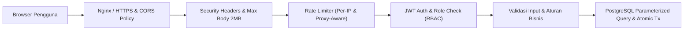

# Panduan Keamanan (Security) — Shoes4Us E-Commerce Platform

Dokumen ini menjelaskan seluruh lapisan keamanan yang telah diterapkan pada platform e-commerce **Shoes4Us** (Frontend React + Backend Go API + Database PostgreSQL). Dokumen ditulis agar mudah dipahami oleh **pemilik bisnis / stakeholder** sekaligus cukup detail sebagai referensi teknis bagi **developer**.

---

## Ringkasan untuk Stakeholder (Non-Teknis)

Dalam bisnis toko online, keamanan berarti melindungi tiga hal utama: **akun pelanggan**, **keakuratan transaksi & stok**, serta **ketersediaan server dari serangan otomatis**. Shoes4Us menerapkan prinsip ***Defense in Depth*** (keamanan berlapis): jika satu lapisan diserang, masih ada lapisan berikutnya yang menahan.

| Area Risiko | Risiko Bisnis Jika Tidak Diamankan | Perlindungan di Shoes4Us |
|---|---|---|
| **Akun & Password** | Akun dibajak, data bocor, atau password ditebak massal | Password diacak satu arah (`bcrypt`), sesi dikunci dengan token bertanda tangan (`JWT HS256`), dan batas percobaan login ketat |
| **Hak Akses** | Pembeli biasa mengubah produk atau melihat pesanan orang lain | Pemisahan peran `USER` dan `ADMIN`, ditambah pengecekan kepemilikan data di setiap permintaan |
| **Checkout & Stok** | Stok minus (*overselling*), pesanan ganda, atau manipulasi harga | Transaksi database atomik, validasi harga & kupon di server, serta proteksi anti pesanan ganda (*Idempotency*) |
| **Serangan Web & Spam** | Server lumpuh karena banjir trafik (*DoS*), injeksi skrip, atau pencurian data | Pembatasan trafik (*Rate Limiter*), batas ukuran payload, CORS ketat, dan header keamanan browser |
| **Upload Gambar** | Penyerang mengunggah file berbahaya yang menyamar sebagai gambar | Hanya admin yang bisa upload, ukuran maks 5 MB, isi file diperiksa (*magic bytes*), dan nama file diacak |

---

## Peta Alur Keamanan Permintaan (Request Security Pipeline)

Setiap permintaan dari browser pengguna melewati rangkaian pemeriksaan berikut sebelum menyentuh data:

---

## 1. Keamanan Autentikasi & Manajemen Akun

### A. Penyimpanan Password Aman (`bcrypt` + Batas 72 Byte)
- **Penjelasan Sederhana:** Password pengguna tidak pernah disimpan dalam bentuk teks asli di database. Sebelum disimpan, password diubah menjadi kode acak satu arah (*hashing*) sehingga tidak bisa dikembalikan ke teks asli sekalipun database diakses.
- **Detail Teknis (`backend/pkg/hash/bcrypt.go`, `backend/internal/service/auth_validation.go`):**
  - Menggunakan algoritma **`bcrypt`** (`bcrypt.DefaultCost`) yang secara otomatis menyertakan *salt* unik di setiap password dan sengaja lambat secara komputasi untuk memperlambat serangan tebak password (*brute-force*).
  - **Standar panjang password seragam:** Minimal **8 karakter Unicode** (rune) dan maksimal **72 byte UTF-8** pada seluruh alur (`Register`, `ResetPassword`, `UpdatePassword`) baik di backend maupun frontend (`frontend/src/utils/auth-validation.ts`).
  - Batas 72 byte divalidasi eksplisit dan menghasilkan error `400 Bad Request` (mengenali `hash.ErrPasswordTooLong`), mencegah error `500` akibat batas internal `bcrypt`.

### B. Token Sesi (`JWT`) & Validasi Secret Produksi
- **Penjelasan Sederhana:** Setelah login, server memberikan "kartu akses digital" bertanda tangan kriptografi bernama **JWT (*JSON Web Token*)**. Jika ada yang mengubah isi kartu (misalnya mengganti peran dari pembeli menjadi admin), tanda tangannya langsung tidak cocok dan ditolak server.
- **Detail Teknis (`backend/pkg/token/jwt.go`, `backend/internal/config/config.go`):**
  - **Algorithm Pinning (`HS256`):** Verifikasi JWT dikunci ketat hanya menerima `HS256` (`jwt.WithValidMethods([]string{"HS256"})`) dan mewajibkan masa berlaku (`jwt.WithExpirationRequired()`). Ini menutup celah klasik *algorithm confusion* seperti `alg: none` atau penggantian ke `HS512`.
  - **Fail-Fast Secret Check (`ValidateRuntimeSecurity`):** Saat aplikasi dijalankan dalam mode produksi (`ENVIRONMENT=production` atau memiliki `FRONTEND_URL`/`CORS_ORIGINS` berbasis `https://` non-lokal), server **menolak menyala** jika `JWT_SECRET` kosong, menggunakan nilai placeholder bawaan, atau panjangnya kurang dari **32 byte**.

### C. Cookie `HttpOnly`, `SameSite`, `Secure` & Pencabutan Sesi (`Logout`)
- **Penjelasan Sederhana:** Server menitipkan token login dalam cookie yang tidak bisa dibaca oleh skrip JavaScript browser (`HttpOnly`), sehingga memperkecil peluang pencurian sesi jika terjadi celah skrip, dan menghapusnya saat pengguna menekan tombol keluar.
- **Detail Teknis (`backend/internal/handler/auth_handler.go`, `frontend/src/context/AuthContext.tsx`, `frontend/src/services/api.ts`):**
  - Cookie `"token"` disetel dengan atribut `HttpOnly: true`, `SameSite: Lax`, `Path: "/"`, `MaxAge` selaras dengan `JWT_EXPIRES_HOURS * 3600`, dan `Secure: true` otomatis ketika memakai HTTPS / `X-Forwarded-Proto: https` / `ENVIRONMENT=production`.
  - Endpoint `POST /api/auth/logout` menghapus cookie sesi (`MaxAge: -1`, `Expires: Unix(0)`).
  - Di sisi frontend, `AuthContext` mendaftarkan *global `401` unauthorized handler* melalui `setUnauthorizedHandler` di `api.ts` agar token kadaluarsa atau tidak sah otomatis membersihkan sesi lokal dan cache API (`clearApiCache()`).

### D. Pencegahan Enumerasi Akun & *Timing Attack*
- **Penjelasan Sederhana:** Penyerang sering mencoba menebak apakah suatu email terdaftar dengan melihat perbedaan pesan error atau perbedaan waktu respons server. Shoes4Us menyamakan perilaku tersebut agar penyerang tidak bisa memetakan daftar email pelanggan.
- **Detail Teknis (`backend/internal/service/auth_service.go`):**
  - **Constant-Time Dummy Check:** Saat login dengan email yang tidak terdaftar, server tetap menjalankan perbandingan `bcrypt` terhadap `dummyBcryptHash` (yang diinisialisasi saat startup) sehingga waktu respons tidak langsung mencolok lebih cepat dibandingkan email terdaftar.
  - **Urutan Validasi Password Sebelum Status Aktif:** Pada `Login`, kecocokan password diverifikasi terlebih dahulu sebelum mengecek `!user.IsActive`. Penyerang yang menebak password salah hanya mendapat `401 Unauthorized`, bukan bocoran bahwa akun tersebut ada tetapi non-aktif (`403 Forbidden`).
  - **Anti-Enumerasi Reset Password:** `ForgotPassword` selalu mengembalikan pesan sukses yang sama meskipun email tidak ditemukan di database.
  - **Akun Non-Aktif Ditolak Saat Refresh Profil:** `GetMe` menolak akun dengan `IsActive == false` (`403 Forbidden`), dan `AuthContext` otomatis membersihkan sesi lokal saat menerima `401`, `403`, atau `404`.

### E. Keamanan Pemulihan Password & Registrasi
- **Token Reset Di-Hash (`SHA-256`):** Token reset password yang dikirim ke pengguna tidak disimpan mentah di tabel `password_reset_tokens`, melainkan hanya hasil hash `SHA-256`-nya (`hash.HashTokenSHA256`), berlaku **1 jam** (`resetTokenTTL`), dan seluruh token lama dihapus setiap kali permintaan baru dibuat atau reset berhasil (`DeleteResetTokensByUser`). Link reset mentah hanya dicetak di log lokal saat `MAIL_HOST` (SMTP) belum dikonfigurasi.
- **Anti Eskalasi Peran (*Mass Assignment*):** Pada `POST /api/auth/register`, struct request hanya menerima `name`, `email`, dan `password`, serta service selalu memaksa `Role: domain.RoleUser`. Field `"role": "ADMIN"` yang disisipkan di payload JSON diabaikan.
- **Unik Case-Insensitive:** Email dinormalisasi huruf kecil dan dijaga di level database dengan indeks unik `idx_users_email_lower` pada `LOWER("email")` (`backend/internal/database/schema.go`).

---

## 2. Kontrol Akses & Otorisasi (RBAC & Anti-IDOR)

- **Penjelasan Sederhana:** Tidak semua pengguna boleh mengakses semua menu. Pembeli hanya boleh melihat dan mengelola profil, keranjang, wishlist, serta pesanannya sendiri, sedangkan pengelolaan produk, katalog, dan status pesanan hanya boleh dilakukan oleh Admin.
- **Detail Teknis (`backend/internal/middleware/auth_middleware.go`, `backend/internal/handler/router.go`):**
  - **Role-Based Access Control (RBAC):**
    - `RequireAuth(jwtMgr)` memverifikasi token (prioritas header `Authorization: Bearer <token>`, fallback ke cookie `"token"`) lalu menyuntikkan `UserClaims` ke `request.Context()`.
    - `RequireAdmin` memastikan `claims.Role == "ADMIN"` pada endpoint sensitif (`/api/upload`, `POST /api/categories`, `POST/PUT/DELETE /api/products`, `GET/DELETE /api/users`, `PATCH /api/orders/{orderId}/status`).
  - **Pencegahan IDOR (*Insecure Direct Object Reference*):**
    - IDOR adalah celah ketika seseorang mengganti ID di URL (misalnya `/api/orders/123` menjadi `/api/orders/124`) untuk mengintip atau mengubah data milik orang lain.
    - `UserService.UpdateProfile` dan `UpdatePassword` memverifikasi `caller.UserID == targetID` (kecuali `ADMIN`), `UserService.DeleteUser` melarang admin menghapus akunnya sendiri, serta `OrderService` dan `PaymentService` memeriksa `order.UserID == userID` sebelum memproses detail, pembatalan, atau pembayaran pesanan.

---

## 3. Keamanan Jaringan, API & Anti-Penyalahgunaan

### A. Pembatasan Trafik (*Proxy-Aware Rate Limiting*)
- **Penjelasan Sederhana:** Untuk mencegah *bot* membombardir server atau mencoba ribuan kombinasi password per menit (*brute-force* / *DoS*), jumlah permintaan per alamat IP dibatasi secara otomatis.
- **Detail Teknis (`backend/internal/middleware/rate_limit_middleware.go`, `backend/internal/handler/router.go`):**
  - **API Umum (`/api/*`):** Maksimal **600 request / menit** per IP.
  - **Endpoint Auth Sensitif (`/register`, `/login`, `/forgot-password`, `/reset-password`):** Maksimal **30 request / menit** per IP.
  - **Anti-Spoofing Header IP:** Header `X-Forwarded-For` / `X-Real-IP` **hanya dipercaya** jika koneksi langsung berasal dari jaringan proxy tepercaya (`TRUSTED_PROXIES`, default: loopback/RFC1918/CGNAT; bisa dimatikan total dengan `none`). Pembacaan `X-Forwarded-For` berjalan dari **kanan ke kiri** sehingga header palsu yang disisipkan penyerang di sisi kiri tidak dapat melewati batas.
  - **Anti Kebocoran Memori:** Jumlah bucket IP dibatasi maksimal **`10.000`** (`defaultMaxBuckets`) dengan pembersihan otomatis entri kadaluarsa dan penggusuran entri tertua (*eviction*) agar serangan dari jutaan IP acak tidak menghabiskan RAM server.
  - Respons menyertakan header standar `X-RateLimit-Limit`, `X-RateLimit-Remaining`, dan `Retry-After` dengan status `429 Too Many Requests`.

### B. Kebijakan CORS Ketat di Produksi
- **Penjelasan Sederhana:** **CORS (*Cross-Origin Resource Sharing*)** menentukan situs web mana saja yang diizinkan browser untuk memanggil API Shoes4Us. Ini mencegah situs asing memanggil API atas nama pengguna tanpa izin.
- **Detail Teknis (`backend/internal/middleware/cors_middleware.go`):**
  - Saat `Production == true`, hanya origin yang terdaftar eksplisit di `CORS_ORIGINS` yang diizinkan.
  - Origin `localhost` / `127.0.0.1` otomatis dinonaktifkan di produksi, dan domain preview `https://*.vercel.app` hanya dibuka jika `CORS_ALLOW_VERCEL_PREVIEWS=true` disetel secara sadar.

### C. Header Keamanan, Batas Payload & Timeout
- **Security Headers (`backend/internal/middleware/security_middleware.go`, `frontend/nginx.conf`):**
  - `X-Content-Type-Options: nosniff` — mencegah browser menebak tipe MIME (*MIME sniffing*) yang dapat mengeksekusi file sebagai skrip.
  - `X-Frame-Options: DENY` (API) dan `SAMEORIGIN` (Nginx frontend) — melindungi dari serangan *Clickjacking* (situs disematkan dalam `<iframe>` tersembunyi).
  - `Referrer-Policy: strict-origin-when-cross-origin` — membatasi bocornya URL internal saat pengguna berpindah ke situs luar.
  - `Permissions-Policy: camera=(), microphone=(), geolocation=()` — mematikan akses perangkat sensitif yang tidak dibutuhkan API.
- **Batas Ukuran Body & Timeout:**
  - `MaxBodySize(2 << 20)` membatasi payload JSON API maksimal **2 MB** (`http.MaxBytesReader`), sedangkan Nginx membatasi `client_max_body_size 15M` untuk kebutuhan upload gambar.
  - `http.Server` menerapkan `ReadHeaderTimeout: 10s`, `ReadTimeout: 15s`, `WriteTimeout: 30s`, `IdleTimeout: 60s`, `MaxHeaderBytes: 1 MB`, serta middleware `chimw.Timeout(30s)` untuk mencegah serangan *Slowloris* dan koneksi menggantung.

---

## 4. Keamanan Database, Transaksi & Integritas Bisnis

### A. Anti-SQL Injection (*Parameterized Queries*)
- **Penjelasan Sederhana:** *SQL Injection* terjadi ketika input pengguna (seperti kolom pencarian atau email) disisipkan langsung ke perintah database sehingga penyerang bisa membaca atau menghapus tabel. Di Shoes4Us, seluruh input dikirim terpisah sebagai parameter, bukan digabung ke teks SQL.
- **Detail Teknis (`backend/internal/repository/*.go`):**
  - Seluruh query PostgreSQL via `jackc/pgx/v5` menggunakan placeholder terparameterisasi (`$1`, `$2`, ...).

### B. Integritas Stok, Harga, Kupon & Anti-Pesanan Ganda
- **Perhitungan Ulang di Server (*Server-Side Source of Truth*):** Harga produk, potongan kupon (`coupon_service.go`), dan total belanja dihitung ulang di server berdasarkan data database — nilai harga dari browser tidak pernah dipercaya mentah-mentah.
- **Transaksi Atomik & Anti-Deadlock (`backend/internal/repository/order_repository.go`):**
  - Saat checkout (`CreateOrderWithTx`), pengurangan stok per ukuran (`WHERE "productId" = $3 AND size = $4 AND stock >= $1`), pengurangan stok total, pembuatan order, pencatatan item, dan pengosongan keranjang dijalankan dalam **satu transaksi database**. Jika salah satu item stoknya kurang, seluruh transaksi dibatalkan otomatis (*rollback*).
  - Item diurutkan secara deterministik (`sortOrderItemsForDeduction`) sebelum memodifikasi baris database untuk mencegah *deadlock* (`SQLSTATE 40P01`) saat dua pelanggan membeli sepatu yang sama bersamaan.
- **Proteksi Idempotency (`backend/internal/handler/order_handler.go`):**
  - Header `Idempotency-Key` (disimpan per pengguna selama 10 menit) mencegah terciptanya dua pesanan identik apabila tombol checkout diklik dua kali atau terjadi *retry* jaringan.
- **State Machine Status Pesanan (`backend/internal/service/order_service.go`):**
  - Perubahan status pesanan dikunci mengikuti aturan `allowedTransitions` (misalnya pesanan `DELIVERED` atau `CANCELLED` bersifat final dan tidak bisa diubah kembali), mencegah manipulasi alur logistik atau pengembalian stok ganda.

---

## 5. Keamanan Upload File & Proteksi Sisi Frontend

### A. Validasi Upload Gambar (`backend/internal/handler/product_handler.go`, `backend/pkg/storage/local.go`)
- Hanya dapat diakses oleh `ADMIN` (`RequireAuth` + `RequireAdmin`).
- Ukuran file dibatasi maksimal **5 MB**.
- **Deteksi Konten Asli (*Magic Bytes*):** Server membaca 512 byte pertama isi file dan memverifikasinya dengan `http.DetectContentType` harus diawali `image/` — sehingga file skrip (`.php`, `.exe`, `.html`) yang diganti namanya menjadi `.jpg` langsung ditolak.
- **Whitelist Ekstensi & Anti Path Traversal:** Hanya ekstensi `.jpg`, `.jpeg`, `.png`, `.webp`, `.gif` yang diterima; nama file asli dibuang dan diganti dengan `UUID` acak; `LocalUploader` membersihkan jalur dengan `filepath.Base` agar tidak bisa menulis file ke luar folder upload (`../../`).

### B. Keamanan di Frontend (`frontend/src/`)
- **Anti Open-Redirect (`frontend/src/utils/auth-redirect.ts`):** Parameter `?redirect=` pada `/login` dan `/register` disaring oleh `sanitizeAuthRedirect` — menolak URL eksternal (`https://evil.com`), *protocol-relative* (`//evil.com`), *backslash*, karakter kontrol, maupun loop redirect ke `/login` atau `/register`.
- **Proteksi XSS Bawaan React & Pembatasan Error Stack:** React secara otomatis melakukan *escaping* terhadap teks yang dirender ke DOM. `ErrorBoundary` (`frontend/src/components/ErrorBoundary.tsx`) hanya menampilkan rincian *stack trace* pada mode development (`import.meta.env.DEV`) dan menyembunyikannya di produksi.
- **Privasi Informasi Bisnis Sisi Pembeli:** Antarmuka pengguna tidak mengekspos angka persis persediaan gudang (*inventory count*), melainkan hanya mencegah pembelian saat produk/ukuran berstatus `HABIS`.

---

## 6. Keamanan Infrastruktur & Container

- **Non-Root Container (`backend/Dockerfile`):** Image produksi backend berbasis `alpine:3.20` (tanpa compiler Go karena memakai *multi-stage build*) dan dijalankan menggunakan user tanpa hak administrator: `appuser:appgroup` (`UID/GID 10001`).
- **Pemisahan Rahasia (*Secret Management*):** File `.env`, `.env.local`, dan `*.pem` dikecualikan oleh `.gitignore` dan `.dockerignore` agar kredensial database, `JWT_SECRET`, SMTP, dan kunci Cloudflare R2 tidak masuk ke repositori Git maupun image Docker.

---

## 7. Transparansi Batasan Saat Ini & Rekomendasi Lanjutan

Sebagai catatan jujur bagi stakeholder dan tim pengembangan sebelum skala trafik membesar:

1. **Penyimpanan Token Ganda (`HttpOnly` Cookie + `localStorage`):** Untuk mendukung skenario deployment lintas domain (Frontend di Vercel dan Backend di Railway/Render), frontend masih menyimpan JWT di `localStorage` dan mengirimnya via header `Authorization: Bearer` di samping cookie `HttpOnly`. Jika suatu saat frontend dan API berada di satu domain utama (misalnya `shoes4us.com` & `api.shoes4us.com`), disarankan beralih penuh ke cookie `HttpOnly` + perlindungan CSRF agar token sama sekali tidak dapat diakses JavaScript.
2. **Rate Limiter & Idempotency *In-Memory*:** Saat ini penyimpanan bucket rate limiter dan cache `Idempotency-Key` berada di memori proses Go. Ini sudah sangat efektif untuk satu instance server, namun jika backend nantinya dijalankan multi-instance (*horizontal scaling*), penyimpanannya perlu dipindahkan ke **Redis**.
3. **Simulasi Pembayaran:** `PaymentService` (`backend/internal/service/payment_service.go`) saat ini mensimulasikan konfirmasi pembayaran. Sebelum menerima pembayaran uang nyata, perlu integrasi ke *payment gateway* resmi (seperti Midtrans/Xendit) lengkap dengan verifikasi tanda tangan *webhook* (*HMAC/signature verification*).
4. **Pengiriman Email Reset Password:** Pengaturan variabel SMTP (`MAIL_HOST`, `MAIL_PORT`, `MAIL_USER`, `MAIL_PASS`, `MAIL_FROM`) sudah tersedia di konfigurasi, namun pengiriman email aktual perlu dihubungkan ke layanan mailer produksi sebelum fitur lupa password digunakan pelanggan secara luas.
